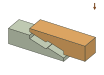
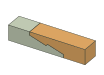

# 略鎌 · Ryakukama

En forlængelse kan skjule et lille modhak mellem to længere skrå flader. I den historiske undersøgelse af ryakukama viser første side både grundformen og flere kombinationer.

## Samleretningen

Her modelleres profilen i figur 2. Den ene del sænkes, så de skrå anlæg og det korte modhak kommer på plads. Andre varianter i afhandlingen kombinerer formen med yderligere indgreb.

## Læs snittet

Længdesnittet viser en faldende linje, et kort stykke med modsat hældning og endnu en faldende linje. De to lave skuldre ved enderne bliver stående. Følg profilens retning før du sammenligner med kamatsugis hals og hoved.

## Ved en besigtigelse

Notér hvor i huset et muligt eksempel er fundet, og hvilke flader der er synlige. Studiet sammenholder netop form, bygningsdel og placering. Betegnelsen alene giver ikke en entydig historisk datering.

[JAANUS · ryakukama](https://www.aisf.or.jp/~jaanus/deta/r/ryakukama.htm) · [Architectural Institute of Japan · fig. 1–3](https://www.jstage.jst.go.jp/article/aijax/356/0/356_KJ00004080403/_pdf#page=1)

[SolidCraft-model](model.sc) · [Modelopskrift](model.json) · [Bogen](../README.md)
