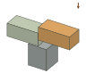

# 真継 · Shintsugi

På fotografiet fra Anzai-huset er stolpen lige så vigtig som fugen. Find dens midte og løft blikket en smule. Lige dér mødes længderne i den vandrette ås, som bærer en del af taget.

Shintsugi er en hjælp til at læse dette sted i huset. På tegningen har åsestykkerne plane ender og stolpen en flad top. Sænk den ene ende på plads ved siden af den anden. Nu kan de dele stolpehovedet mellem sig. I andre udførelser kan der også være en nøgle, og en rund ås kan få et krumt sæde.

Lægger man de to åsestykker alene på et bord, mister man det væsentligste spor. Det er først sammen med stolpen, at tegningen fortæller, hvor forbindelsen hører hjemme.

[JAANUS · shintsugi](https://www.aisf.or.jp/~jaanus/deta/s/shintsugi.htm)

[SolidCraft-model](model.sc) · [Modelopskrift](model.json) · [Bogen](../README.md)
