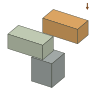
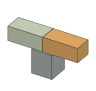

# 真継 · Shintsugi

To åsestykker mødes over stolpens midte. Her ligger oplysningen først og fremmest i placeringen af stødet. JAANUS viser også et eksempel fra Anzai-huset.

## Samleretningen

Modellen isolerer placeringen med to rektangulære ender på et plant stolpehoved. Sænk det andet emne på den frie halvdel. Kildens muligheder for nøgle og afrundet sæde er ikke med i denne variant.

## Læs snittet

Det lodrette snit viser den lodrette stødlinje direkte over stolpens midte. Her er sædet fælles, men hvert emne har sin egen del af anlægsfladen.

## Ved en besigtigelse

Find midterlinjerne for både stolpe og fuge. Går samlingen ud over understøtningen, har du en anden placeringssituation, selv når de ydre endeflader ser ens ud.

[JAANUS · shintsugi](https://www.aisf.or.jp/~jaanus/deta/s/shintsugi.htm)

[SolidCraft-model](model.sc) · [Modelopskrift](model.json) · [Bogen](../README.md)
