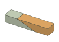
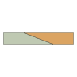

# 殺継 · Sogitsugi

Forestil dig et let spær, der skal forlænges. I stedet for en kort endeflade kan to skrå snit lægges mod hinanden langs spæret.

## Samleretningen

Hold den grønne del stille og før den anden ned, så de to skrå flader mødes langs hele snittet. Placeringen skal holdes under samlingen.

## Læs snittet

Længdesnittet viser den lange skrå kontaktflade. Her er ingen hage, som mekanisk låser de to stykker på langs. JAANUS beskriver søm gennem samlingen; de er udeladt i træmodellen.

## Ved en besigtigelse

Følg de to tynde spidser. En streg på spærsiden siger noget om snitretningen. Den kan alene hverken vise sømmenes tilstand eller dokumentere samlingens kapacitet.

[JAANUS · sogitsugi](https://www.aisf.or.jp/~jaanus/deta/s/sogitsugi.htm)

[SolidCraft-model](model.sc) · [Modelopskrift](model.json) · [Bogen](../README.md)
