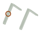
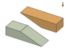
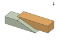

# 殺継 · Sogitsugi

Lad øjet følge et let spær hen over en samling. Fugen begynder på den ene side og kommer først ud på den anden et godt stykke længere henne. Begge spærender er skåret skråt. Den lange skrå samling hedder sogitsugi.

Læg den ene skrå flade ned mod den anden. De passer sammen langs hele snittet, og i hver ende løber træet ud i en tynd spids. Fladerne kan stadig glide mod hinanden. I den traditionelle udførelse, som JAANUS beskriver, går der også søm gennem samlingen. Her er træet vist, før sømmene kommer i.

Sammenlign med sædet på siden før. Begge samlinger forlænger træet. Men på sædet ender den vandrette flade brat ved en skulder; på spæret kan fingeren følge én jævn skråning helt ud til spidsen.

[JAANUS · sogitsugi](https://www.aisf.or.jp/~jaanus/deta/s/sogitsugi.htm)

[SolidCraft-model](model.sc) · [Modelopskrift](model.json) · [Bogen](../README.md)
