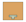
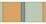

# Kanawatsugi · to ender og én nøgle

Her ligger snittene i den samme låste model. De to første er parallelle tværsnit i hver sin ende af overlappet, set i samme retning.

Ved venstre skulder tilhører T-hovedet den ene bjælke; ved højre skulder tilhører det den anden. T-hovederne kan derfor ikke passere lodret ud gennem de smalle halse, når begge er i deres lommer.

Når nøglen er ude, kan enderne forskydes aksialt, indtil T-hovederne slipper lommerne. Først da kan delene løftes fra hinanden. I den låste model gav et forsøg på én millimeters løft geometrisk overlap mellem trædelene. Prøven dokumenterer indgrebet; den giver ingen brudkraft.

[JAANUS · de to originaldiagrammer](https://www.aisf.or.jp/~jaanus/deta/k/kanawatsugi.htm)
