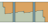

# Okkake-daisen-tsugi · find begge stifthuller

På den øverste tegning kan du lede længe efter stifterne. Et lille stykke længere nede i nøjagtig samme bjælke kommer de begge til syne. Det eneste, der har flyttet sig, er snittet.

Følg den skrå fuge ud til siden i det øverste billede. Den viser vejen, de to træstykker kan mødes ad. Først når de ligger på plads, kan stifterne føres gennem begge dele. På nederste tegning kan du se, hvor de krydser fugen.

Prøv nu at forestille dig bjælken med en mur tæt op ad siden. Er der plads til den bevægelse, du lige har fulgt? Det spørgsmål er værd at stille, længe før man løfter et nyt stykke tømmer op i et gammelt hus.

[JAANUS · okkake daisentsugi](https://www.aisf.or.jp/~jaanus/deta/o/okkakedaisentsugi.htm)

[JAANUS · kanawatsugi](https://www.aisf.or.jp/~jaanus/deta/k/kanawatsugi.htm)
