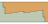

# Okkake-daisen-tsugi · find begge stifthuller

Begge snit er vandrette, parallelle og lagt i den samme model. Det øverste åbner de to profiler; det nederste går gennem stifternes midterhøjde.

Læs den samme ende af samlingen på begge billeder. Profilerne ligger i identisk position. Det ekstra blågrå træ i nederste billede skyldes udelukkende snittets højde. Stifterne går gennem begge emner efter samling.

Gå tilbage til kanawatsugi-tavlens T-profil. Okkake-modellen har en åben sidevej til samling, mens kanawa-endestykkerne kræver en sidste bevægelse på langs. Den forskel er relevant ved udskiftning af ét stykke i et eksisterende fag.

[JAANUS · okkake daisentsugi](https://www.aisf.or.jp/~jaanus/deta/o/okkakedaisentsugi.htm)

[JAANUS · kanawatsugi](https://www.aisf.or.jp/~jaanus/deta/k/kanawatsugi.htm)
