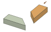
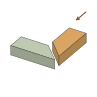
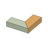

# 留 · Tome

Du kan kende en gering på en billedramme længe før du kender det japanske ord tome. De to lister drejer om hjørnet, og mellem dem løber en skrå, smal fuge.

I et retvinklet hjørne kan tømreren dele drejningen i to snit på 45 grader. Før den ene liste hen til den anden. Når enderne mødes, går fugen fra hjørnets inderste punkt til det yderste. Her har begge lister en enkel skrå endeflade.

Snittet gennem hjørnet viser den samme diagonal, som man kan se udenpå. På næste side kan du prøve at gætte indmaden ud fra den samme fuge. Denne gang snyder den.

[JAANUS · tome](https://www.aisf.or.jp/~jaanus/deta/t/tome.htm)

[SolidCraft-model](model.sc) · [Modelopskrift](model.json) · [Bogen](../README.md)
