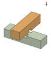

# 渡腮 · Watariago

Ved en krydsning kan to indhug i underemnet lade en ryg stå i midten. Den øvre del har en modsvarende rille. Her er valgt opslagets retvinklede krydsprincip.

## Samleretningen

Hold rillen over ryggen, og sænk overemnet, så det griber om den. Den mulige ekstra skjulte stift, som opslaget omtaler, er udeladt.

## Læs snittet

I tværsnittet står der træ tilbage midt mellem de to lavere felter. Overemnets underside har en fordybning netop her.

## Ved en besigtigelse

Se også watarikaki. Det afgørende spørgsmål er, om underemnet faktisk er bearbejdet. En synlig udskæring i overemnet afgør det ikke alene.

[JAANUS · watariago](https://www.aisf.or.jp/~jaanus/deta/w/watariago.htm)

[SolidCraft-model](model.sc) · [Modelopskrift](model.json) · [Bogen](../README.md)
