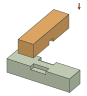
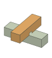
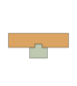

# 渡腮 · Watariago

Midt på underbjælken står en smal ryg. Tømreren har fjernet træ på begge sider af den, og i overbjælkens underside er der skåret en rille, der passer ned omkring ryggen.

Sænk overbjælken vinkelret på den nederste. Et øjeblik kan du se, hvordan de lave felter nærmer sig hinanden. Så lukker krydset, og ryggen forsvinder. I nogle forbindelser føjes også en skjult stift til; her kan du se træformen for sig.

Sammenhold det åbne kryds med watarikaki. Begge overbjælker har en udskæring på undersiden. Den oplysning, der skiller dem, ligger nedenunder: Er underbjælken hel, eller kan du finde ryggen?

[JAANUS · watariago](https://www.aisf.or.jp/~jaanus/deta/w/watariago.htm)

[SolidCraft-model](model.sc) · [Modelopskrift](model.json) · [Bogen](../README.md)
