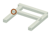
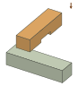
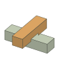

# 渡欠 · Watarikaki

Løft den øverste bjælke og lad blikket blive på den nederste. Dens overside er hel. Ved denne watarikaki ligger tømrerens indhug i det stykke, der lige er blevet løftet.

Vend blikket mod undersiden af det øverste stykke. Udskæringen har plads til underbjælkens bredde. Når stykket sænkes, går de to fremspring ned på hver sin side af underbjælken.

Prøv at tegne underbjælken alene, sådan som den ligger tilbage. Gem det enkle rektangel i hukommelsen. På næste side skal samme bjælke have en ganske anden ryg.

[JAANUS · watariago](https://www.aisf.or.jp/~jaanus/deta/w/watariago.htm)

[SolidCraft-model](model.sc) · [Modelopskrift](model.json) · [Bogen](../README.md)
