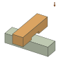
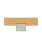

# 渡欠 · Watarikaki

Overemnet kan gribe ned over et helt, ubearbejdet underemne. JAANUS beskriver denne enklere variant i opslaget om watariago.

## Samleretningen

Vend udskæringen i overemnet nedad, og lad de to fremspring passere på hver sin side af underemnet.

## Læs snittet

Tværsnittet viser underemnets fulde rektangel. Overemnets udsparing omfatter dets overkant, og der er ingen smal ryg i midten af underemnet.

## Ved en besigtigelse

Tegn de to varianter ved siden af hinanden. Markér med én farve, hvor der måtte fjernes træ fra den nederste del i hvert tilfælde.

[JAANUS · watariago](https://www.aisf.or.jp/~jaanus/deta/w/watariago.htm)

[SolidCraft-model](model.sc) · [Modelopskrift](model.json) · [Bogen](../README.md)
